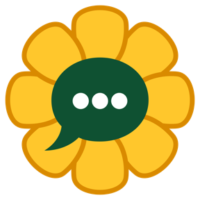
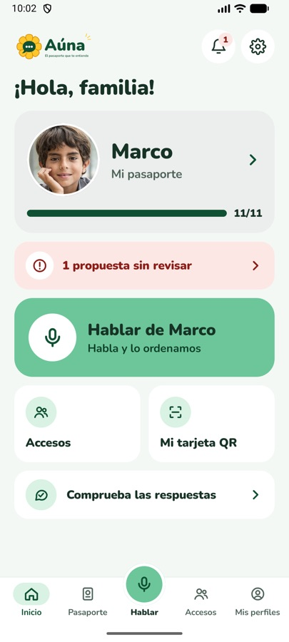
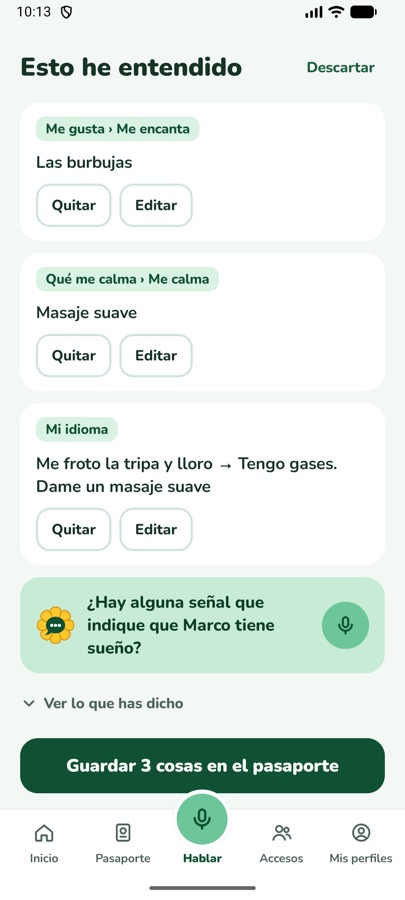
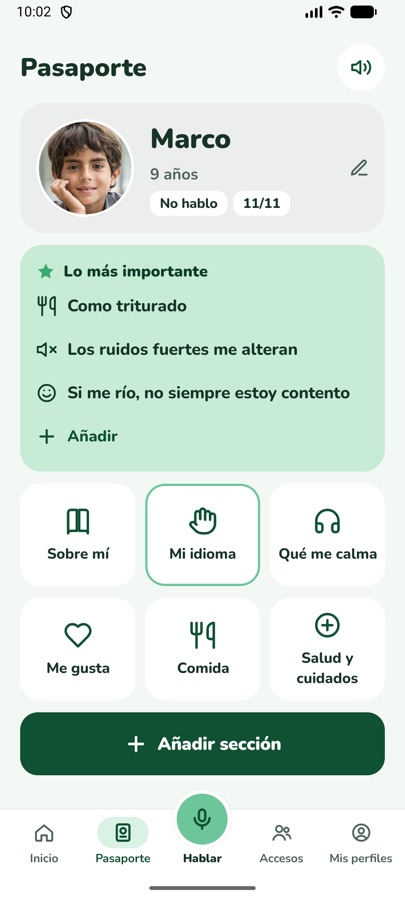
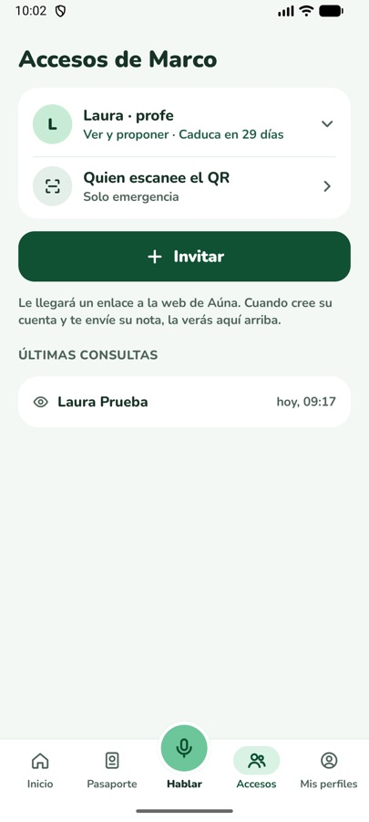
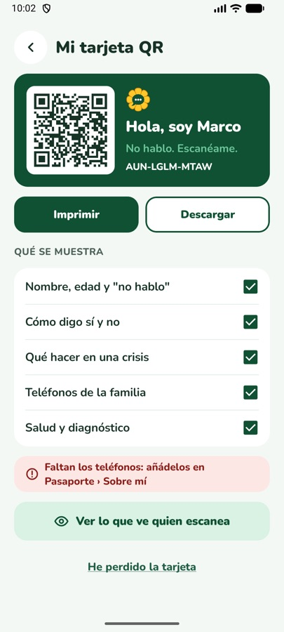
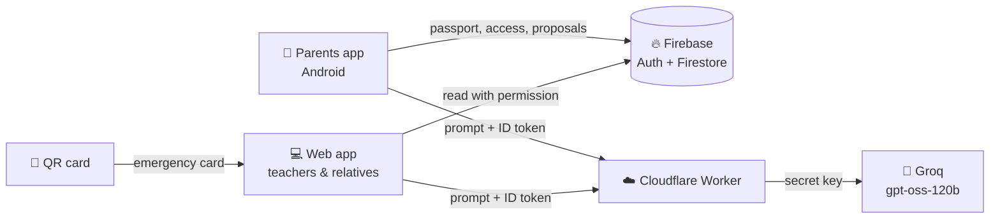

<div align="center">



# Aúna

**Their gestures are words too.** · **Sus gestos también son palabras.**

A digital communication passport for children who don't speak, built by their families with the help of AI and shared with everyone who looks after them.

[](#-the-hackathon)
[](#-the-hackathon)
[](#-the-hackathon)
[](app-padres)
[](web)

[**Website**](https://paolagdiazz.github.io/auna/) · [**Web app**](https://paolagdiazz.github.io/auna/app/) · [**Download the Android app**](https://github.com/paolagdiazz/auna/releases/latest)

[English](#english) · [Español](#español)

</div>

<p align="center">
  
  
  
  
  
</p>

---

## English

### 💡 The problem

Many children with autism, Angelman syndrome or other conditions don't speak, but they communicate all the time: a gesture, a sound, a way of moving. Their families understand them. A new teacher, a substitute, a summer camp monitor or an ambulance crew usually don't.

Today families solve this with a **paper communication passport**: laminated cards that say what each gesture means and how to respond. It helps, but it gets lost, stays at home and never changes when the child changes.

### 🌻 Our solution

**Aúna** turns that passport into something alive:

- **Families talk, AI organises.** A parent explains how their child communicates, out loud or in writing, as they would to a friend. The AI sorts it into the passport sections and the parent reviews every item before it is saved.
- **Always up to date.** Yes and no, what each gesture means, what calms them, food, and what to do in a crisis. Everything can be edited in seconds and read aloud.
- **The family decides who sees it.** Teachers and carers ask for access with a note. The family chooses who gets in, for how long and whether they can suggest changes, and sees who has looked at it.
- **Ask in plain words.** "How do I know if something hurts?" The assistant answers only with what the family has written, and says so when it doesn't know.
- **An emergency card.** A QR code on a wallet card. Whoever scans it sees the essentials, can call the family and can share their location. No app needed.
- **Built for real use.** Pictograms from ARASAAC, voice input in Spanish, large type and a calm visual style.

### 🧩 What's in this repo

| Folder | What it is |
| --- | --- |
| [`app-padres/`](app-padres) | Android app for parents and legal guardians (Kotlin, Jetpack Compose, Material 3). |
| [`web/app/`](web/app) | Web app for teachers, monitors and relatives ([live](https://paolagdiazz.github.io/auna/app/)). |
| [`web/`](web) | Landing page that doubles as our pitch deck: press space or → to present ([live](https://paolagdiazz.github.io/auna/)). |
| [`worker/`](worker) | Cloudflare Worker that keeps the AI key secret and only answers signed-in users. |
| [`firebase/`](firebase) | Firestore security rules. |
| [`marca/`](marca) | Brand kit: logos, app icons, QR cards, colour palette and typography. |
| [`docs/`](docs) | Setup guide and development notes. |

### 🏗️ How it works



- **Android app:** Kotlin, Jetpack Compose, Material 3, Android speech recognition and text to speech, ZXing for QR codes. Talks to Firebase through its REST API, so the APK stays around 3 MB.
- **Web app:** Preact and htm with no build step, Firebase JS SDK, ARASAAC pictograms. Served by GitHub Pages.
- **AI:** Groq (`openai/gpt-oss-120b`) with structured JSON output, behind a Cloudflare Worker that verifies Firebase ID tokens. The parents app can also use your own Groq or Claude key.
- **Everything runs on free tiers:** Firebase Spark, Cloudflare Workers Free, Groq Free and GitHub Pages.

### 🚀 Try it

- **Web app:** open https://paolagdiazz.github.io/auna/app/ and sign in with the demo teacher account `prueba.profe@auna.test` (password `prueba`).
- **Android app:** download the APK from [Releases](https://github.com/paolagdiazz/auna/releases/latest) and install it. Your phone may ask you to allow apps from unknown sources. The demo family account is `prueba.familia@auna.test` (password `prueba`).
- **Pitch:** open the [website](https://paolagdiazz.github.io/auna/) on a computer and press space or → to go through the presentation.

All children's data in the demo is made up. Marco and Lucas are example profiles.

### 🛠️ Run it yourself

```bash
git clone https://github.com/paolagdiazz/auna.git
cd auna/app-padres
./gradlew assembleRelease   # APK in app/build/outputs/apk/release/
```

The web app has no build step: serve the `web/` folder with any static server (for example `python3 -m http.server -d web`). To connect your own Firebase project, Cloudflare Worker and Groq key, follow [docs/SETUP.md](docs/SETUP.md).

### 🏆 The hackathon

Aúna was designed and built in **16 hours** at the **Hackathon IA First** (November 2026), in the **social challenge** track, by team **HashRate**.

We validated the idea with a foundation that works with families, with relatives, and with private schools and town halls. We also kept the whole stack on free tiers so the project can keep running after the event.

### 👩‍💻 Team HashRate

- Julia Hernández Palma
- Julieta González Vargas
- María Vázquez López
- Paola Gambero Díaz
- Rubén Granados Mayorgas

### 🙏 Credits

- Pictograms: [ARASAAC](https://arasaac.org) (Government of Aragón, CC BY-NC-SA).
- Map data: © [OpenStreetMap](https://www.openstreetmap.org/copyright) contributors.
- Typography: [Nunito](https://fonts.google.com/specimen/Nunito) (SIL Open Font License).

---

## Español

### 💡 El problema

Muchos niños y niñas con autismo, síndrome de Angelman u otras condiciones no hablan, pero se comunican todo el rato: con un gesto, un sonido o una forma de moverse. Su familia les entiende. Una profe nueva, una sustituta, el monitor del campamento o la ambulancia, normalmente no.

Hoy las familias lo resuelven con un **pasaporte comunicativo de papel**: tarjetas plastificadas que explican qué significa cada gesto y cómo responder. Ayuda, pero se pierde, se queda en casa y no cambia cuando el niño cambia.

### 🌻 Nuestra solución

**Aúna** convierte ese pasaporte en algo vivo:

- **La familia habla y la IA lo ordena.** La madre o el padre cuenta cómo se comunica su hijo, hablando o escribiendo, como se lo contaría a una amiga. La IA lo coloca en las secciones del pasaporte y la familia revisa cada cosa antes de guardarla.
- **Siempre al día.** Cómo dice sí y no, qué significa cada gesto, qué le calma, qué come y qué hacer en una crisis. Todo se cambia en un momento y se puede escuchar en voz alta.
- **La familia decide quién lo ve.** Profes y monitores piden acceso con una nota. La familia elige quién entra, durante cuánto tiempo y si puede proponer cambios, y ve quién lo ha consultado.
- **Preguntar con palabras normales.** «¿Cómo sé si le duele algo?». El asistente responde solo con lo que ha contado la familia, y lo dice cuando no lo sabe.
- **Una tarjeta para emergencias.** Un QR en una tarjeta de cartera. Quien lo escanea ve lo imprescindible, puede llamar a la familia y enviar su ubicación. Sin instalar nada.
- **Pensada para usarse de verdad.** Pictogramas de ARASAAC, dictado por voz en español, letra grande y un estilo visual tranquilo.

### 🧩 Qué hay en este repositorio

| Carpeta | Qué es |
| --- | --- |
| [`app-padres/`](app-padres) | App Android para madres, padres y tutores legales (Kotlin, Jetpack Compose, Material 3). |
| [`web/app/`](web/app) | Web para profes, monitores y familiares ([en línea](https://paolagdiazz.github.io/auna/app/)). |
| [`web/`](web) | Página de presentación que también es nuestro pitch: pulsa espacio o → para presentar ([en línea](https://paolagdiazz.github.io/auna/)). |
| [`worker/`](worker) | Cloudflare Worker que guarda en secreto la clave de la IA y solo responde a personas con sesión iniciada. |
| [`firebase/`](firebase) | Reglas de seguridad de Firestore. |
| [`marca/`](marca) | Kit de marca: logotipos, iconos de app, tarjetas QR, paleta de colores y tipografía. |
| [`docs/`](docs) | Guía de puesta en marcha y notas de desarrollo. |

### 🏗️ Cómo funciona

- **App Android:** Kotlin, Jetpack Compose, Material 3, reconocimiento de voz y lectura en voz alta de Android, ZXing para los QR. Habla con Firebase por su API REST, así el APK pesa unos 3 MB.
- **Web:** Preact y htm sin paso de compilación, Firebase JS SDK y pictogramas de ARASAAC. Publicada en GitHub Pages.
- **IA:** Groq (`openai/gpt-oss-120b`) con salida JSON estructurada, detrás de un Cloudflare Worker que comprueba los tokens de Firebase. La app de padres también puede usar tu propia clave de Groq o de Claude.
- **Todo en planes gratuitos:** Firebase Spark, Cloudflare Workers Free, Groq Free y GitHub Pages.

El diagrama de arriba, en la parte en inglés, muestra cómo se conectan las piezas.

### 🚀 Pruébalo

- **Web:** abre https://paolagdiazz.github.io/auna/app/ y entra con la cuenta de prueba de profe `prueba.profe@auna.test` (contraseña `prueba`).
- **App Android:** descarga el APK en [Releases](https://github.com/paolagdiazz/auna/releases/latest) e instálalo. El móvil puede pedirte permitir apps de origen desconocido. La cuenta de prueba de familia es `prueba.familia@auna.test` (contraseña `prueba`).
- **Pitch:** abre la [página](https://paolagdiazz.github.io/auna/) en un ordenador y pulsa espacio o → para pasar las diapositivas.

Todos los datos de niños de la demo son inventados. Marco y Lucas son perfiles de ejemplo.

### 🛠️ Ejecutarlo tú

```bash
git clone https://github.com/paolagdiazz/auna.git
cd auna/app-padres
./gradlew assembleRelease   # APK en app/build/outputs/apk/release/
```

La web no necesita compilarse: sirve la carpeta `web/` con cualquier servidor estático (por ejemplo `python3 -m http.server -d web`). Para conectar tu propio proyecto de Firebase, tu Worker de Cloudflare y tu clave de Groq, sigue [docs/PUESTA-EN-MARCHA.md](docs/PUESTA-EN-MARCHA.md).

### 🏆 El hackathon

Aúna se diseñó y se construyó en **16 horas** en el **Hackathon IA First** (noviembre de 2026), en el **reto social**, por el equipo **HashRate**.

Validamos la idea con una fundación que trabaja con familias, con familiares, y con colegios privados y ayuntamientos. Además montamos todo en planes gratuitos para que el proyecto pueda seguir funcionando después del evento.

### 👩‍💻 Equipo HashRate

- Julia Hernández Palma
- Julieta González Vargas
- María Vázquez López
- Paola Gambero Díaz
- Rubén Granados Mayorgas

### 🙏 Créditos

- Pictogramas: [ARASAAC](https://arasaac.org) (Gobierno de Aragón, CC BY-NC-SA).
- Datos del mapa: © colaboradores de [OpenStreetMap](https://www.openstreetmap.org/copyright).
- Tipografía: [Nunito](https://fonts.google.com/specimen/Nunito) (SIL Open Font License).
